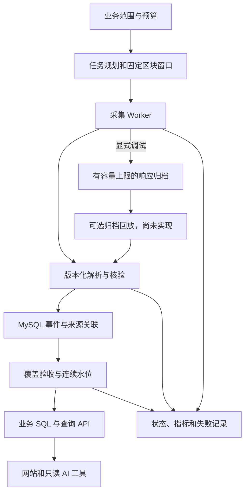

# ChainScope 业务工程方案与学习路线

初版日期：2026-10-12；基线更新：2026-10-19。项目按可解释、可验证的工程任务推进，不修改原学习计划。本文区分已实现基线和后续目标；当前操作见 README、architecture.md 和 operations.md。

## 1. 当前基线与判断

已实现：Alchemy 分页暂存与正式提交、精确金额、MySQL 事务与唯一约束、迁移 0001～0009、任务及连续水位、分页恢复、独立池子/Swap 补充、持仓缓存，以及服务列表范围内的 DeepSeek 采集 Agent、后台执行和事件报告。

2026-10-19 完整回归记录为 358 项通过、2 项可选模型测试跳过、5 项 subtests 通过，真实模型兼容检查另行通过。同日 BEM 正式增量完成到 19:40:00、区块 128547796，结束报告已生成。此前 20 区块、8 条事件属于早期证据，不再代表当前全部验证范围。上述结果仍不能推导所有来源绝无遗漏、任意代币机制均支持、持续运行或规模性能已全面验收。

功能范围分阶段交付，工程保证从第一阶段进入设计、实现与验收。周次安排学习重点，不是延迟正确性、恢复能力和运行证据的理由。

## 2. 先定义业务承诺

本项目建议的首个业务范围：指定 BSC 代币的标准 ERC-20 转账历史与持续增量，用于地址活动、转入/转出和日级转账统计，后续提供 API、网站和只读 AI 查询。

每个交付数据集必须明确：

- 链 ID、合约、事件类型、部署/起始区块、结束区块与最终性策略。
- 零金额、零地址、铸币/销毁、自转账和合约地址的处理口径。
- 历史回填范围、更新频率、可接受延迟和上游费用/请求预算。
- 覆盖状态、已验收连续区块水位、来源、解码版本和已知限制。
- 业务指标的统计粒度、时区、单位和解释边界。

BSC、服务列表、配置范围内的 Transfer/Swap/池子和预算已有实现；新增范围仍需明确配置，不能由模型自行扩大。Transfer 金额合计不是交易所成交量；一笔交易可以产生多个 Transfer；地址不等于用户。持仓重建还依赖完整历史、初始状态及代币机制，不能从任意时间段的净转账推导当前余额。研究分析和长期 memory 暂不列入当前采集阶段验收。

### 2.1 分析阶段待处理的 BEM 数据口径（2026-10-23 记录）

以下来自截至区块 129131520 的只读核查。采集数据本身准确，不需要修改采集代码；这些是清洗和统计阶段必须定义的口径，未处理前不得直接按原始行数或买卖方向汇总得出结论。

| # | 现象（核查证据） | 不处理的后果 | 分析阶段的处理方向 |
| --- | --- | --- | --- |
| 1 | 挖矿铸币占转账绝大部分：发送方为零地址的 Transfer 有 5,364,074 条，约占全部 7,060,622 条的 76%，累计约 406,513 BEM。铸币交易由矿工钱包调用挖矿合约 `0x7e2e0dc66a3bd9103e69b766afa62d9f7b697b46`，新币直接铸给矿工钱包；收到铸币次数最多的地址 `0x6688928b01768c92e5f6fafbcf381bee23727395` 约 310 万次（身份未核实） | 转账笔数、活跃地址、"交易活跃度"被挖矿奖励撑大 | 零地址转出单独归为“产出”，与普通转账和交易分开统计；矿工、疑似矿池地址单独标注 |
| 2 | 过路交易：BEM/TapeRobot 池（`0x818b63ea…`）2134 笔 Swap 中，2044 笔在同一交易里还有另一个 BEM 池的反方向 Swap（例如 USDT→BEM→TapeRobot），BEM 只在池子之间流转，发起人没有持有 | 同一笔交易同时计为 BEM 买入和卖出，买卖量都被高估；按地址的交易者排名大多无法归属 | 同一交易内合并所有 BEM 池子的进出，按净流向判定为买、卖或过路；过路交易不计入买卖压力 |
| 3 | 未识别合约：池子 1 另有 53 笔交易者不明的交易，BEM 来自合约 `0x28e2ea090877bf75740558f6bfb36a5ffee9e9df`（约 24 KB 代码、不是标准 V2/V3 池、持有约 1237 BEM，近期活跃），公开搜索未找到身份 | 如果它是其他交易所，目前只采 PancakeSwap V2/V3，会漏掉这部分买卖 | 先在 BscScan 等来源核实身份；若为交易所，再评估把对应工厂或池子类型纳入采集 |
| 4 | 池子 1 的成交另一侧是 TapeRobot，没有美元价格 | 无法换算美元成交额 | 只统计 BEM 数量；如需美元口径，另定换算来源并标注 |

以上数据为当日快照；统计口径定稿前须重新核查最新数据。

## 3. 目标数据流

基础设施基线采用现有 Python + MySQL；正常 collect 默认不保存响应文件。显式调试归档受容量限制；大规模文件归档是否有必要，必须先确定追溯/回放承诺和成本，不能默认永久保存全部副本。任务规划、采集、解析、校验、持久化和服务层职责仍须明确。

## 4. 数据源选择是成本与覆盖问题

Alchemy 是目前已授权、实测可用的数据源，继续作为默认提供商。采集层通过统一记录格式隔离供应商专有的 uniqueId/pageKey，不让业务 SQL 依赖某一家 API 的字段。

| 路线 | 适用情况 | 必须验证 |
| --- | --- | --- |
| alchemy_getAssetTransfers | 快速查询目标代币的标准转账历史 | 支持范围、索引延迟、分页有效期、字段与遗漏风险 |
| eth_getLogs + 合约/topic 过滤 | 标准事件采集及对照核验 | 区块/响应限制、时间范围与日志数量边界、费用 |
| 历史索引数据源 | 大范围回填成本或速度不能满足预算时评估 | 链覆盖、字段质量、链头延迟、重组策略和重建能力 |

eth_getLogs 的区块限制不能套用到 Transfers API，价格和账号额度也不能由旧记录推断。来源切换沿用明确的暂存与核验规则，不在失败时把部分结果标为完整。

预算估算：请求成本 = 转账页数 × 每页成本 + 唯一区块查询成本 + 回执核验成本 + 重试成本。实际吞吐和额度根据账户与代表性范围测量，不能仅估算分页请求。

## 5. 范围任务、执行尝试与水位分开

需要区分三个对象：

1. 逻辑任务：采集哪个链/合约/固定范围，任务身份稳定。
2. 执行尝试：一次运行可能成功、限流、超时或被中断；每次有 attempt_id。
3. 业务水位：从起点开始，连续且已通过覆盖验收的最大区块，不能越过失败空洞。

现有 scan_jobs、coverage_windows、transfer_ingestion、pending_transfers 已分别承担任务、窗口、分页和暂存职责，Agent 另有计划、运行、尝试及事件表；不再按旧方案重复创建 sync_checkpoints。collection_batches、transfer_events、batch_events 保留批次、事件和关联。只有明确用途才增加其他业务表，完整回执不必全展开为关系表。

固定范围两端包含。普通连续窗口下一起点是前一终点 + 1；重叠回扫是明确标记的恢复策略。空窗口也需要成功采集证据，而不是因没有事件就假定已覆盖。

## 6. 分页游标不能替代永久断点

pageKey 不能作为永久断点；当前代码保存窗口和游标时间，超过安全时长后重查该窗口。持久化断点包含逻辑范围、分页状态、参数和版本及已提交进度，不以供应商游标永久有效为前提。

游标仍有效可以继续；游标失效后重新查询同一固定窗口，通过事件幂等和归档关联避免重复。不能直接跳到最后一个已看到的区块 + 1，因为那一个区块中可能还有未取完的事件。

先实现单 Worker 和明确的恢复规则。引入多 Worker 时再增加任务租约、过期恢复和抢占互斥；不能只加并发而不定义任务归属。

## 7. 原始归档和数据库各自承担什么

2026-10-13 已按用户要求调整：正常 collect 只在 MySQL 保存事件、批次和关联，raw_directory 为 NULL；不产生全量 JSON 或 events.json。任务追踪以数据库记录为准。已有历史文件保留。

显式 --save-raw 或 fetch 用于有限调试，按 raw/<batch-id> 嵌套一层保存 RPC 响应与摘要；单批默认 10 MiB，总文件内容上限 100 MiB。容量检查和文件发布使用共享锁，临时文件原子替换，超限明确失败，不自动删除文件。没有实现压缩、自动到期清理和回放。

调试归档与数据库不是共同事务：归档写入失败会使未提交任务失败；MySQL 已提交之后，摘要更新失败不会将成功批次改为失败。若未来确有大规模归档业务需求，再定义保留期、校验和、清理与恢复；不因可选文件功能阻碍默认无文件路径。

MySQL 备份与恢复需要独立设计和验证；可选原始响应回放不能代替数据库备份，也不是本项目默认必须提供的能力。

## 8. 事务与幂等的具体保证

推荐采用可重复采集、数据库幂等写入的方式。使用唯一约束防止重复事实；不同内容的同一身份必须记录差异并进入核验，不能静默覆盖金额或把 INSERT IGNORE 当成通用错误处理。

一小批事件、来源关联和对应处理进度应在同一个 MySQL 事务提交：提交前中断可以重放；提交后中断可以从数据库已提交状态恢复。采集窗口只有在所有页结束、覆盖核验和数量对账通过后才能标记完成，业务查询根据连续水位或完整窗口过滤，避免使用半成品。

批量预取既有事件、批量比较和写入，避免逐事件 SELECT。批量大小受内存、锁持有时长、MySQL 包限制和测量结果约束，不承诺固定万能值。死锁和临时断线有有限重试；提交结果不确定时通过任务身份与数据库状态核对，不能直接重试整个任务后误报重复结果。

当前 uint256 原值字符串和唯一键可保留。后续需明确金额查询策略：字符串不能直接按数值 SUM/排序；规范非负十进制字符串的数值排序可以按位数再按字符排序，或使用有明确上界的业务数值列。聚合和可能超过单事件 uint256 上限，应另定容量。Decimal 运算也需显式设置精度，不默认使用 28 位上下文。

## 9. 链上数据的最终性和完整性

业务终点优先使用已实测支持的节点 finalized 状态；若提供商不支持，使用显式配置并注明保障等级的确认深度策略。现有减 12 个区块只是保守深度，不等价于 finalized。

早期 finalized 标签探测超时属于 2026-10-12 历史记录；当前 sync 和 Agent 已使用最终确认高度，并完成真实 BEM 固定时间运行。网络失败仍不能解释为方法不支持，也不以旧批次数量描述当前数据库。

区块哈希用于定位规范链身份。读取未最终确认链头时，需要记录父哈希、检测分叉、标记孤块事件并重建受影响指标。发生预期之外的最终区块冲突，应停止推进和调查，不自动覆盖。

分页耗尽证明本次接口请求结束；交易回执核验只证明返回事件匹配，不证明上游未漏返回；同一家提供商两条接口对照也不等于独立数据源验证。

覆盖核验分为窗口连续性、页数/数量对账、正样本字段对照、无事件窗口对照、重叠范围事件集合比对和按风险选取独立来源。提供商索引延迟与节点最终性是两回事；没有索引水位时需明确保守延迟/回扫策略，不能声称绝对实时完整。

## 10. 业务可用的接口与运行证据

状态命令/API 至少报告：请求范围、已验收连续范围、最终区块、水位延迟、来源、尝试次数、事件数量、失败窗口、费用/请求计数。没有完整覆盖时，业务查询返回明确的部分覆盖状态或拒绝计算，不用 0 或空数组掩盖失败。

运行指标至少有 rows/sec、RPC 延迟、429 次数、失败率、每批事务时长、内存峰值、归档字节、请求成本估算及积压窗口。日志按 job_id/attempt_id/range 定位，隐藏密钥和密码。进程中断后留下 running 状态需有可恢复的任务识别方法。

数据库使用业务与迁移权限分离的账号；只读 API/AI 使用受限查询权限和固定参数化工具。部署、备份、恢复、迁移和健康检查有可复现命令。监控通知外发需用户明确配置，当前不创建外发通知。

## 11. 从冒烟测试走到业务验收

| 验收 | 必须能观察到的结果 |
| --- | --- |
| 同范围多次重跑 | 规范事件集合、金额和水位一致，执行记录可区分 |
| 处理窗口中杀进程 | 从未提交窗口重新查询，已提交事件安全复用，不假报完成 |
| 提交前杀进程 | 小批回滚，恢复后不会跳过事件 |
| 提交后、更新运行日志前杀进程 | 从已提交数据库状态恢复，无重复事实 |
| 停机超过游标有效期 | 重查固定窗口后完整恢复，不丢区块内剩余事件 |
| 限流/超时/服务断线 | 有限等待、可恢复状态、可定位原因 |
| 上游记录冲突/遗漏/空窗口 | 不静默标完整，有可复现差异证据 |
| 未来明确启用回放时，文件损坏或丢失 | 完整性检查阻止错误回放；不作为默认采集路径前提 |
| 修改解码版本 | 重新查询固定范围对账；记录版本与变化，不要求默认保留全量响应 |
| 新环境与数据库恢复 | 依赖、迁移、配置和恢复步骤可复现 |

先以 8 条验证连接；再选择稀疏、密集、多日志交易、合法空范围和铸币/销毁的代表性真实窗口。性能按 1 千、1 万、10 万等有实际来源的规模递增，记录硬件、配置、耗时和费用；百万条是否适用取决于业务覆盖和真实数量，不能造数据凑业务总量。模拟容量数据只能进入独立测试环境。

吞吐、刷新时长、恢复时长、请求与磁盘预算是需测量后确定的目标，不在本文编造已经达到的 SLA。

## 12. 结合 10 周路线

| 阶段 | 学习重点 | 真实工程交付与完成证据 |
| --- | --- | --- |
| W1 Python | 请求、函数/类、异常、配置、类型 | 清楚的数据合同、限定任务、原始证据、进度结构、有限重试、本人解释、Git 与可复现命令 |
| W2 MySQL/SQL | 约束、事务、索引、分析口径 | 分批入库、同事务进度、三类业务 SQL、覆盖范围与准确汇总；数据库选型按用户确认的 MySQL |
| W3 ETL | 历史回填、增量、恢复、最终性 | 自动续跑、游标过期恢复、连续水位、回放/对账、失败注入和容量证据 |
| W4 API | 参数、分页、服务边界 | 查询/汇总/状态接口，明确覆盖状态，与 SQL 一致 |
| W5 AI 工具 | 受限工具与评估 | 基于已验收数据回答，返回范围/来源/水位，固定问题对照 SQL，缺数据不编造 |
| W6 工作流 | 状态、分支、终止 | 保留工具执行依据，超时和失败有明确出口 |
| W7 RAG | 文档版本、检索、引用 | 可定位证据与无依据处理，不将陈旧文档当实时链上事实 |
| W8 运行管理 | 调度、指标、告警 | 数据管道持续运行验收、积压与故障恢复证据；不是到 W8 才开始记录错误 |
| W9 部署集成 | 环境、权限、服务、备份 | 网站/API/数据库完整链路，新环境部署和恢复演练 |
| W10 求职交付 | 演示、技术说明、权衡 | 业务结果、性能/成本/故障证据、本人讲解及版本历史 |

周次为顺序参考，允许提前完成。能力成熟度由证据决定。第一周不做完整 10 周系统，但要把业务承诺和失败/恢复的边界设计清楚，并把不完整能力明确标记。

下一轮实施顺序：先落定数据合同和验收表；再实现逻辑范围任务、持久进度、按固定窗口重新查询与幂等恢复；随后优化分批事务并扩大代表性范围；最后做故障注入、容量和持续运行验收。归档回放仅在明确需要时实施；现有精度、约束和核验代码保留。

## 13. 独立审查 AI 方案的框架

每次审查按以下顺序留下自己的结论：

1. 业务：谁用什么数据回答什么问题，错误后果是什么？
2. 合同：覆盖范围、粒度、单位、最终性和更新时间是否明确？
3. 状态：任务、尝试、进度和业务完整水位分别存在哪里？
4. 边界：外部请求、文件发布、数据库提交之间是否原子，哪里会出现半成功？
5. 恢复：在每个边界杀进程或停机后，下一次怎样继续？
6. 正确性：如何发现重复、遗漏、错误金额、错误链或链重组？
7. 容量：时间、内存、连接数、存储和 API 费用的上界是什么？
8. 证据：哪些只是设计，哪些是模拟，哪些在真实环境验证，哪些是本人完成？

对每个函数都能指出输入、输出、副作用、失败方式和恢复位置；对每张表都能说出事实粒度、唯一键、来源和业务用途。让 AI 给出假设、替代方案、失败案例和验收办法，再验证其结论。

可复用要求：先说明业务范围和质量承诺；列出组件及状态/事务边界；说明分页、重复、遗漏、游标过期、停机和重组时的处理；给出容量与成本估算及失败注入测试；区分已实现与计划；按小步实现并让我解释关键改动，不用运行成功截图替代工程验收。

## 核对来源

- [Alchemy Transfers API](https://www.alchemy.com/docs/data/transfers-api/transfers-endpoints/alchemy-get-asset-transfers)
- [Alchemy 分页与游标 TTL](https://www.alchemy.com/docs/docs/reference/transfers-api-quickstart)
- [Alchemy BSC eth_getLogs 范围限制](https://www.alchemy.com/docs/chains/bnb-smart-chain/bnb-smart-chain-api-endpoints/eth-get-logs)
- [BSC Finality API 与 finalized 标签](https://docs.bnbchain.org/bnb-smart-chain/developers/json_rpc/bsc-api-list/)
- [MySQL 批量写入](https://dev.mysql.com/doc/refman/8.0/en/optimizing-innodb-bulk-data-loading.html)
- [MySQL 死锁处理](https://dev.mysql.com/doc/refman/8.0/en/innodb-deadlocks-handling.html)
- [ERC-20 标准](https://eips.ethereum.org/EIPS/eip-20)

以上用于解释来源约束；本方案的数据合同、架构和验收门槛是结合用户目标提出的项目设计。
